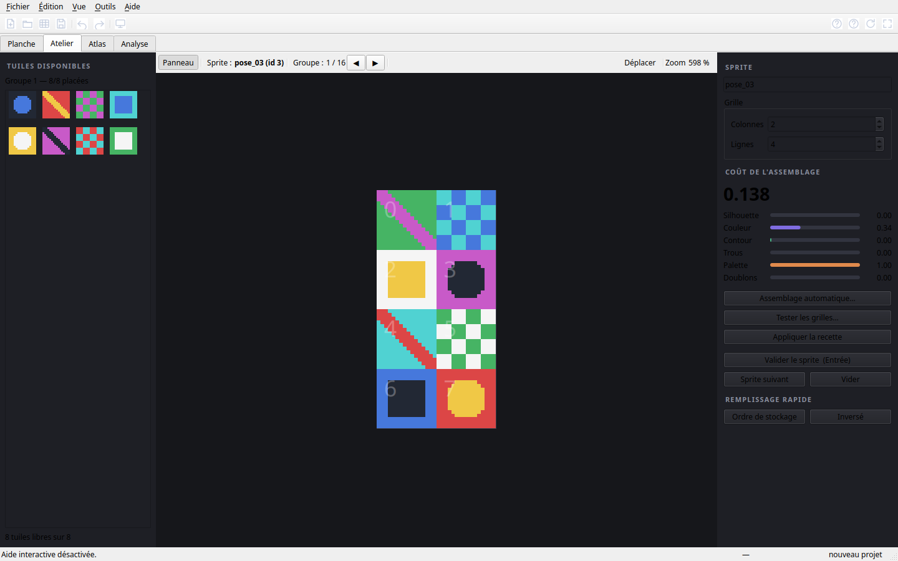
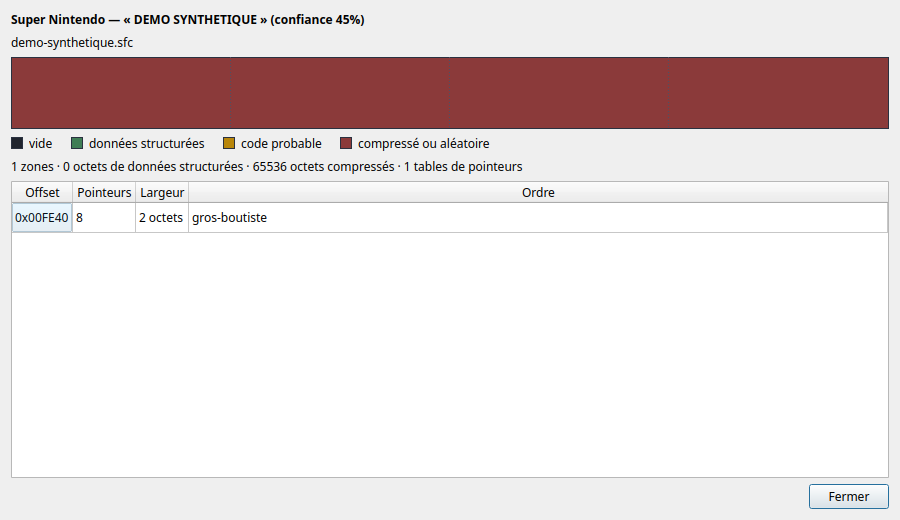
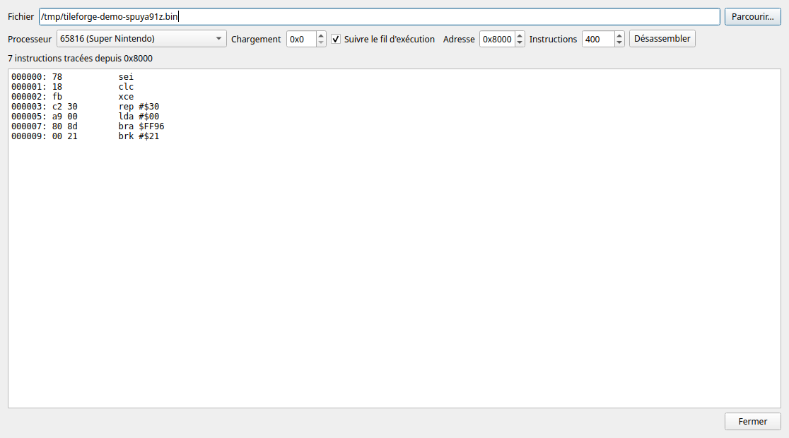

# TileForge — recovering sprites from tile sheets

A graphical tool for finding the **original assembly** of sprite tiles in an
8 or 16-bit game, then inferring the **ordering logic** its developers used.

It loads a sheet (PNG, or a binary bank extracted from a ROM), splits it into
tiles, proposes automatic assemblies, lets you correct them with the mouse,
produces an atlas and exports the data for analysis.

*[Version française](README.md)* — repository: <https://github.com/vingaut/tileforge>



---

## 1. Install and run

```bash
git clone <your-repository> tileforge
cd tileforge
./run.sh                 # creates the virtual environment on first run
```

Or manually:

```bash
python3 -m venv .venv
.venv/bin/pip install -e ".[gui]"
.venv/bin/python -m tileforge
```

Dependencies: **Python ≥ 3.10**, **PySide6** (interface), **numpy** (maths),
**Pillow** (tolerant PNG reading; a built-in decoder takes over if absent).
**zip** archives use the standard library; **7z** uses `py7zr` or the system
`7z` command.

```bash
.venv/bin/python -m tileforge docs/planche_demo.png
.venv/bin/python -m tileforge --selftest        # check the installation
.venv/bin/python -m tileforge --mcp             # MCP server on stdin
```

Guides: **[detailed install](docs/INSTALL.md)**, **[BIOS and
firmware](docs/BIOS.md)**, **[connect an LLM](docs/mcp-clients.md)**,
**[publishing](docs/PUBLISHING.md)**. Libretro cores are downloaded with
`python tools/fetch_cores.py`; no copyrighted BIOS is bundled.

A Linux x86_64 build is published in the
[1.4.2 release](https://github.com/vingaut/tileforge/releases/tag/v1.4.2)
(`tileforge-1.4.2-linux-x86_64.tar.gz`).

---

## 2. Quick start — demonstration sheet

The repository contains a synthetic sheet, `docs/planche_demo.png`, generated
from scratch: no game content.

1. **Sheet** tab → **PNG image…** → `docs/planche_demo.png`.
2. The tool detects a 16 × 16 grid; tiles are numbered.
3. **Workshop** tab → grid **2 × 4** → **Automatic assembly…** → *Try
   everything* → double-click a result.
4. Adjust with the mouse if needed, then **Validate the sprite**.
5. **Analysis** tab → **Infer** after a few sprites, then **Create the
   recipe** and **Apply to the whole bank**.

The **Barbarian** walkthrough remains available in the app (**Help ▸ Help and
tutorial**, Ctrl+F1) for users who own the original disk. No game content is
bundled with TileForge.

---

## 3. The four tabs

| Tab | What it does |
|---|---|
| **Sheet** | load, split, edit tiles; six detectors; quality control; palette editor |
| **Workshop** | assemble sprites, live cost C1–C6, automatic assembly M1–M6 |
| **Atlas** | lay out validated sprites, export PNG + JSON |
| **Analysis** | ordering hypotheses, rule inference, recipes, log, exports |

**Detectors**: fixed grid, period (autocorrelation), projection profiles,
XY-cut, connected components, manual.

**Solvers**: M1 ordering hypotheses, M2 greedy + 2-opt, M3 beam search,
M4 simulated annealing, M5 exhaustive (≤ 10 tiles), M6 optimal path (1 × N).

**Costs**: C1 silhouette, C2 colour, C3 outline, C4 holes, C5 palette,
C6 duplicates — with adjustable weights.

---

## 4. Resolution and machines

On a screenshot the tool detects any upscaling (×2, ×3, ×4), derives the
native resolution, counts colours, estimates colour depth, looks for the grid
pitch by autocorrelation, and identifies the machine against a catalogue of
**76 systems** (22 consoles, 29 computers, 25 arcade boards).

On a raw bank the image size is meaningless: the analysis then works on the
tile profile and proposes compatible machines.

---

## 5. Raw bank formats

25 tile-format presets: SNES (2, 3, 4, 8 bpp), Mega Drive (4bpp planar), Game Boy
Advance (4 and 8 bpp), NES, Game Boy, Master System, PC Engine, Neo Geo, CPS-1,
Atari ST (Barbarian, sprites), Amiga, CPC modes 0/1/2, ZX Spectrum, C64,
chunky 4/8 bpp. A **Custom** mode
exposes width, height, bits per pixel, layout, bit order, bytes per tile and
row padding.

---

## 6. Compressed banks

| Format | Machine | Typical games | Validated by |
|---|---|---|---|
| **Kosinski** | Mega Drive | Sonic 2/3, QuackShot, Phantasy Star IV | official test vectors |
| **Kosinski moduled** | Mega Drive | Sonic 3 & Knuckles | official vector + injected decoder |
| **Nemesis** | Mega Drive | Sonic, Golden Axe, Streets of Rage | constructed vectors |
| **Saxman** | Mega Drive | Sonic 2 (music, sound driver) | official vector |
| **Enigma** | Mega Drive | Sonic, Golden Axe, Chaotix (tilemaps) | official vectors |
| **Comper** | Mega Drive | — | constructed vectors |
| **Sonic RLE** | Mega Drive | Sonic 1/2 (level data) | constructed vectors |
| **SNES LZSS** (0x100) | Super Nintendo | tilemaps, many games | constructed vectors |
| **LC_LZ2** | Super Nintendo | Super Mario World, Yoshi's Island | constructed vectors |
| **LC_LZ3** | Super Nintendo | SMW hacks; Pokémon Gold/Silver (SnesLab) | constructed vectors |
| **LZ77 / LZ11** | Game Boy Advance, Nintendo DS | GBA BIOS, NDS files | constructed vectors |
| **Pokémon Crystal LZ** | Game Boy | Pokémon Crystal, Gold/Silver | reference decompressor |
| **PackBits** | Apple II, Mac, CPC, Amiga | — | round-trip |
| **RLE** (2 variants) | 8-bit in general | — | round-trip |
| zlib / gzip | — | homebrews, romhacks | standard library |

Every decoder has a test. A decoder that never terminates is discarded during
a scan (a stream that reaches the size ceiling has not met an end marker).

### Reading emulator memory

Some games decompress their graphics at run time, or build them in RAM. When
static analysis runs out, **Tools ▸ Emulator memory…** runs the ROM in a
**libretro** core (RetroArch, mGBA, Snes9x, Genesis Plus GX, Hatari…), advances
a few hundred frames, then copies **system RAM**, **VRAM** and **SRAM**. The
graphics are already decompressed there, in the machine's native format.

TileForge ships neither emulator nor ROM: it discovers installed cores
(`~/.config/retroarch/cores`, `/usr/lib/libretro`, `TILEFORGE_CORES`) or takes
an explicit path. The dialog writes one `.bin` per region, a concatenated file,
a PNG screenshot and a JSON manifest with indicative base addresses. An input
script such as `start@120-140` reaches the game screen.

```bash
python tools/emulator_memory.py --list-cores
python tools/emulator_memory.py \
    --core ~/.config/retroarch/cores/mgba_libretro.so \
    --rom game.gba --frames 900 --buttons "start@120-140" \
    --output memory/game --screenshot --scan
```

The MCP tool `tileforge_emulator_memory` does the same; `scan=true` scans the
memory and returns candidates with their region and offset. Since the game has
already decompressed the data, raw scanning is enough. The host has been
checked with a fake core and with **Snes9x** on Final Fight (300 frames,
128 KB WRAM, 64 KB VRAM, Metro City map screenshot, 4bpp tiles found in VRAM).

Emulators that are not libretro cores can also provide a **raw dump**:
`--import-memory` scans a `.bin` file (with `--base` and `--system`) or a
manifest. This is the path used with Hatari, whose `savebin` debugger command
writes Atari ST RAM:

```bash
python tools/emulator_memory.py --import-memory barb_ram.bin \
    --base 0 --system atarist --tile-format barbarian_st --scan
```

### Opening zip/7z archives

ROM packs are almost always compressed. TileForge opens a `.zip` or `.7z`
directly: it lists the members, picks the most likely ROM (or the one you
choose) and works on its contents, with no manual extraction.

* in **Raw bank…**, the file filter accepts `*.zip` and `*.7z`; a **Member**
  list appears to choose the disk or file;
* the MCP tool `tileforge_list_archive` lists members, and every read tool
  accepts `archive_member`;
* on the command line: `--member` for `scan_compressed.py` and `render_blob.py`,
  `--archive-member` for `emulator_memory.py`.

`tileforge/core/archives.py` has no mandatory dependency: `zipfile` for zip,
`py7zr` or the `7z` command for 7z.

### Finding graphics automatically

**Find graphics…** scans the whole file: raw data at coarse steps then refined
to the byte, compressed blocks offset by offset with a 4 KB probe, decompressors
spread over the available cores. Each area gets a **graphics plausibility
score** (0 to 1) and a preview; neighbouring windows are merged into one block.

The score combines four structure indices (spatial coherence, run length,
palette economy, rarity of single-pixel runs) and a **variety veto** that
rejects blocks made of identical tiles. The weights are fitted on a labelled
corpus by `tools/calibrate_score.py`: AUC 0.985, cross-validated 0.981 ± 0.034.

On large ROMs, `structured_only` restricts the search to the areas the
cartography classifies as *structured data*: on Final Fight, 131 KB instead of
1 MB, eight times faster, same candidates.

### Identifying an unknown format

**Identify the format…** compares each candidate format to **its own noise
floor**. Without that reference a 1-bit format "explains" anything and always
wins. Depth and plane layout are reliable; tile size still has to be checked by
eye.

---

## 7. ROM cartography



**Tools ▸ Map a ROM…** shows:

* the **platform**, recognised from the header (iNES signature, `SEGA` at
  0x100, Nintendo logo, SNES complementary checksum, `TMR SEGA`);
* a **zone strip** classified by entropy — empty, structured data, likely code,
  compressed or random;
* **pointer tables**: runs of increasing values pointing into the ROM, often
  the entry point to graphics;
* **data blocks** delimited by consecutive pointers.

On the four working ROMs the header is recognised and the title displayed:
`FINAL FIGHT`, `ACTRAISER-ARCADE`, `AERO BLASTERS`, `THUNDER FORCE 4`.

---

## 8. Disassembly



**Tools ▸ Disassemble…** decodes **6502** (NES, C64, Apple II, Atari 8-bit…),
**Z80** (ZX Spectrum, Amstrad CPC, MSX…), **SM83** (Game Boy), **68000**
(Mega Drive, Amiga, Atari ST) and **65816** (SNES) code. Two modes:

* **linear** — decode from a file offset;
* **tracing** — start from a processor address (a LoROM reset vector is
  `0x8000`) and follow jumps, branches and subroutines, with a return stack.
  Jump tables (`jmp (table,x)`) are followed entry by entry.

The disassembler exists to find the addresses code loads — the only path left
when a game uses a home-made compressor. Known limit: the tracer does not model
the stack frame of indirect calls, so coverage is partial.

---

## 9. Game profiles

A **profile** remembers everything needed to find a game's graphics: file,
offset, tile format, compression, palette, grid. It is a plain JSON file,
readable and shareable. **File ▸ Game profiles…** lists the built-in profiles
and yours; one click loads the bank (the ROM is looked for automatically).

Personal profiles live in `~/.config/tileforge/profiles/`; sharing one means
copying a JSON file.

### Adding a decompressor

```python
from tileforge.core.compression import register

def my_game(data, offset=0):
    ...                      # decode
    return bytes(output)

register("my_game", my_game, "My game (1993)", "Mega Drive")
```

The format then appears in the *Compression* list and in the scan.

---

## 10. MCP server

TileForge embeds a **Model Context Protocol** server: an assistant can drive
the tool with the same functions as the interface.

```bash
python -m tileforge --mcp          # JSON-RPC 2.0 on stdin
python tools/mcp_config.py --check # real handshake: 26 tools expected
```

The server is **stdio**: the LLM client launches it. To avoid the classic
"client uses the system Python instead of the venv" mistake, generate the
configuration with the current interpreter:

```bash
python tools/mcp_config.py                    # Claude Desktop
python tools/mcp_config.py --client cursor    # Cursor
python tools/mcp_config.py --client vscode    # VS Code
python tools/mcp_config.py --client claude-code
```

```json
{
  "mcpServers": {
    "tileforge": {
      "command": "/path/to/tileforge/.venv/bin/python",
      "args": ["-m", "tileforge", "--mcp"]
    }
  }
}
```

The repository also contains project configs: `.mcp.json` (Claude Code),
`.vscode/mcp.json` (VS Code) and `.cursor/mcp.json` (Cursor). Open TileForge as
the workspace and these clients discover the server automatically. **Claude
Desktop** has no project discovery: use its global config file.

Client-specific paths and troubleshooting: [docs/mcp-clients.md](docs/mcp-clients.md).

**26 tools**: `inspect_file`, `list_tile_formats`, `list_systems`,
`read_palette`, `list_archive`, `cartography`, `scan_graphics`,
`list_emulator_cores`, `emulator_memory`, `identify_format`, `disassemble`,
`preview_tiles`, `open_bank`, `project_info`, `list_tiles`, `auto_assemble`,
`render_sprite`, `validate_sprite`, `save_project`, `export_atlas`,
`open_disk`, `extract_disk_file`, `decompress_nested`, `amiga_screen`,
`amiga_sprites`, `amiga_analyze`.

Each returns JSON **and the path of a PNG preview**, so the model can look
before deciding. No external dependency, no Qt needed.

---

## 10 bis. Agent skill — `tileforge-rea`

The repository ships a **DSH skill** so the agent does not start from scratch
on every game: [`.dsh/skills/tileforge-rea/SKILL.md`](.dsh/skills/tileforge-rea/SKILL.md).
It is discovered automatically when the repository is the workspace (a
`.dsh/skills` root), and a global link `~/.dsh/skills/tileforge-rea` makes it
available from other folders.

It contains the five-step playbook (inventory → locate → decode → verify →
capitalise), the TileForge MCP / REA tool map, per-system pitfalls, the
repository workflow for adding formats/decompressors/tools, and the case notes
in [`docs/cases/`](docs/cases/README.md) (Zelda NES, Project-X Amiga,
template).

After each extraction, write a case note in `docs/cases/`: that memory is what
prevents re-analysing the disk, the compressor and the palettes next time.

---

## 11. Languages

The interface is available in **French, English and German**. Choose it in
**Help ▸ Language**; the choice is remembered, and the system language is
detected on first run.

French is the source language: strings are written in French in the code and
the catalogues in `tileforge/i18n/` map them. An untranslated string shows in
French, never as a technical key.

```bash
python tools/extract_strings.py --missing en    # what remains to translate
```

---

## 12. Files

| Extension | Content |
|---|---|
| `.tileforge.json` | complete project (sheet embedded as base64 PNG, tiles, sprites, atlas, log, recipes) |
| `.autosave.json` | automatic save every 60 s |
| `.csv` / `.json` | placement exports |
| `.txt` | readable permutations (storage index → slot) |
| `.pal` / `.gpl` | palettes |

Settings: `~/.config/tileforge/settings.json` (Linux),
`%APPDATA%\tileforge\settings.json` (Windows), the app's private folder on
Android. Reset with `python -m tileforge --reset-settings`.

---

## 13. Architecture

```
tileforge/
├── core/
│   ├── image.py            RGBA image + PNG (Pillow or built-in decoder)
│   ├── archives.py         read ROMs inside zip/7z archives
│   ├── compression.py      Kosinski (+moduled), Nemesis, Saxman, Enigma,
│   │                       Comper, Sonic RLE, LC_LZ2, LC_LZ3, LZ77/LZ11,
│   │                       PackBits, RLE, zlib
│   ├── amigadisk.py        ADF/ADZ/HDF, OFS/FFS, tolerant checksums
│   ├── imploder.py         Imploder (10 signatures, backward decompression)
│   ├── rnc.py              RNC ProPack methods 1 and 2
│   ├── nested.py           recursive descent into nested formats
│   ├── hunk.py             Amiga hunk executables (segments, relocations)
│   ├── copper.py           copper lists (planes, palette, geometry)
│   ├── planar.py           planar screens, geometry, 0x0RGB palettes
│   ├── amigasprites.py     components, grid, pre-shift, animations
│   ├── emulation.py        libretro host, emulator memory, snapshots
│   ├── disasm6502.py       6502 disassembler
│   ├── disasmz80.py        Z80 and SM83 (Game Boy) disassemblers
│   ├── disasm68000.py      68000 disassembler
│   ├── disasm65816.py      65816 disassembler and code tracing
│   ├── cartography.py      platform, entropy, pointer tables
│   ├── score.py            calibrated graphics plausibility score
│   ├── scan.py             scanning engine (raw + compressed, budget)
│   ├── identify.py         tile format identification
│   ├── formats.py          raw bank decoders + presets
│   ├── model.py            Sheet, Tile, Grid, Sprite, Atlas, Project, Recipe
│   ├── palettes.py         ST/Amiga/NES/GB/SMS/MD/CPC/C64/ZX/EGA palettes
│   ├── systems.py          76-machine catalogue
│   ├── detectres.py        resolution analysis and identification
│   ├── project_io.py       project I/O and exports
│   ├── i18n.py             translation catalogues
│   └── updates.py          manifest, download, install, rollback
├── detect/                 six tile detectors + quality control
├── assemble/               costs C1–C6, hypotheses M1–M6, rule inference
├── games/                  Barbarian (STX → FAT12), generic loaders
├── mcp/                    MCP server and 26 tools
└── ui/                     four screens, dialogs, help, SVG icon set, themes

.dsh/skills/tileforge-rea/  agent skill (TileForge + REA playbook)
docs/cases/                 per-game case notes (extraction memory)
```

The core (`core`, `detect`, `assemble`) does not depend on Qt and can be used
as a library.

```python
from tileforge.core.formats import FORMATS_BY_KEY, load_raw_bank
from tileforge.core.model import Sheet
from tileforge.assemble.cost import build_cost_model
from tileforge.assemble import solvers

fmt = FORMATS_BY_KEY["snes_4bpp"]
bank = load_raw_bank("rom.bin", 0x10000, 64, fmt)
sheet = Sheet(image=bank.image, source="rom.bin", kind="raw")
for index, rect in enumerate(bank.tile_rects()):
    sheet.add_tile(rect, storage_index=index)
group = [t.id for t in sheet.tiles_sorted()[:8]]
model = build_cost_model(sheet, group)
for sol in solvers.solve("M3", model, 2, 4, {"width": 400})[:3]:
    print(sol.method, round(sol.cost, 3), sol.order)
```

---

## 14. Shortcuts

| Key | Action |
|---|---|
| Ctrl+O / Ctrl+S | open / save |
| Ctrl+Z / Ctrl+Y | undo / redo |
| Ctrl+1..4 | Sheet, Workshop, Atlas, Analysis |
| V / R / H | select / new tile / pan |
| G | snap |
| 0 / 1 | fit / actual size |
| Wheel, pinch | zoom |
| Space + drag | pan |
| Delete | remove |
| Enter | validate the sprite |
| F1 | interactive help |
| Ctrl+F1 | help page |
| F11 | full screen |

---

## 14 bis. Multi-system demonstration

`../tileforge-demo/` (next to the repository) contains a real demonstration:
for nine machines, a game run in a libretro core, its screenshot, tile sheet,
sprite proposal and the raw emulator memory.

```bash
python tools/build_demo.py \
    --roms-root /path/to/roms \
    --cores /path/to/libretro-cores \
    --output ../tileforge-demo
```

Covered machines: NES, Super Nintendo, Mega Drive, Game Boy, Game Boy Advance,
Master System, PC Engine, ZX Spectrum, Amstrad CPC. ROMs are not copied: only
the generated images, a bank excerpt and JSON reports are written.

## 14 ter. Case studies — two games extracted with zero human intervention

Two complete extractions were carried out **from a single prompt**, with no
human action afterwards: no offset picked with the mouse, no palette fixed by
eye, no sprite cut by hand.

| | **The Legend of Zelda** (NES) | **Project-X** (Amiga) |
|---|---|---|
| Input | `.nes` ROM, MMC1, 8 PRG banks, 0 CHR | 4 `.ipf` disk images |
| Hard parts | offsets, 3 assembly rules, palettes | IPF → MFM → OFS → Imploder → hunk |
| Output | 15 blocks, 3 rules, 10 palettes, 65 files | 28 files, 31 nested blocks, 10 sheets, 1,043 sprites |
| TileForge's role | central (scan, banks, atlas) | entry point and format recognition |

The full chain, the verification oracles and the tools used (MCP, REA, rizin,
capstone, SPS library, Imploder) are described in
[`docs/ETUDES_DE_CAS.md`](docs/ETUDES_DE_CAS.md) (French).

Follow-up work was listed in
[`docs/tileforge_upgrade.md`](docs/tileforge_upgrade.md): Amiga disk support,
decompressors (including **recursive nested detection**), hunk parser,
**plane-major "screen" mode** next to the "tiles" mode, palette extraction and
matching, automatic sprite cutting.

## 14 quater. Amiga chain (1.5.0)

Version 1.5.0 implements most of that roadmap:

* **Disks**: ADF/ADZ/HDF, OFS and FFS, invalid checksums tolerated (Copylock),
  IPF and DMS recognised with an explanation.
* **Compression**: Imploder (10 signatures including `ATN!`) and RNC ProPack
  methods 1 and 2 with an optional key, then **recursive descent** into nested
  blocks.
* **Executables**: hunks (segments, relocations, load address) and copper lists
  (bitplanes, palette, geometry).
* **Graphics**: row-major and plane-major planar rendering, 1 to 8 planes, free
  stride, geometry and padding detection, `0x0RGB` palettes matched by colour
  continuity.
* **Sprites**: connected components, morphological closing, grid, pre-shift,
  animation grouping and RGBA sheet export.

Command line: `python tools/amiga.py list|extract|nested|screen|sprites|hunk|copper`.
Full guide, Python API and limits: [`docs/AMIGA.md`](docs/AMIGA.md).

> No extracted artwork is published in this repository: the works remain with
> their rights holders. Only formats, offsets and metrics are documented.

## 15. Tests

```bash
python tests/run_all.py       # 283 tests, no interface required
python -m tileforge --selftest
python tools/calibrate_score.py    # score calibration report
python tools/bench_solvers.py      # assembly solver benchmark
```

---

## 16. Known limits

* Machine identification is indicative: many systems share the same resolution.
* Bank decoding assumes regular, uncompressed tiles; game-specific RLE/LZ
  formats need a plugin.
* Rule inference needs several validated sprites whose tiles carry a storage
  index (so a raw bank, not a PNG).
* The assembly cost is informative but not decisive: the true order beats 95 %
  of random arrangements, yet the exhaustive solver finds it exactly only 17 %
  of the time — hence the previews.
* The 65816 tracer does not model the stack of indirect calls, so coverage is
  partial.
* On Android the screen is small and drag-and-drop is replaced by two-step
  placement.
* IPF (CAPS/SPS) and DMS are detected but not decoded; convert them to ADF.
  CrunchMania, Turbo Packer and StoneCracker are recognised without a decoder.
* Planar geometry detection ranks candidates; on very repetitive patterns
  several offsets may score alike. Check the preview.

---

## 17. Repository policy

The repository contains **no commercial game content**. ROMs, disks and
graphics extracted from games are excluded by `.gitignore`; test data is
generated by the tests themselves. See [CONTRIBUTING.md](CONTRIBUTING.md).

## License

MIT — see [LICENSE](LICENSE).

*TileForge — Python 3 / PySide6 / numpy.*
