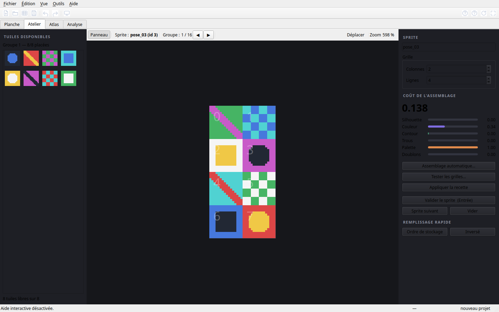
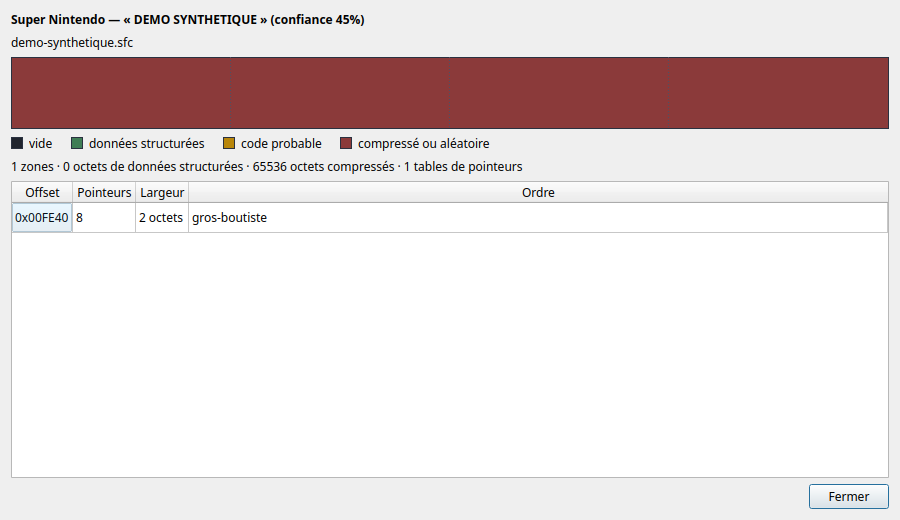
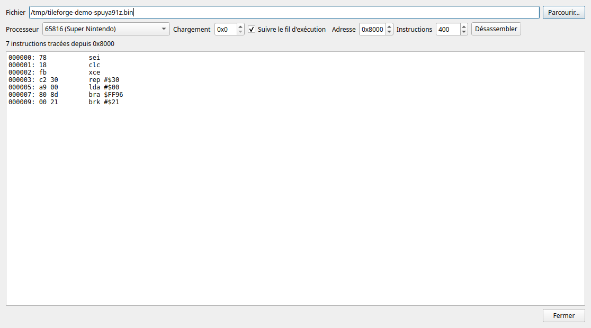

# TileForge — reconstruction de sprites à partir de planches de tuiles

Outil graphique pour retrouver l'**assemblage d'origine** des tuiles de sprites
d'un jeu 8/16 bits, puis en déduire la **logique d'ordonnancement** utilisée par
les développeurs.

Il charge une planche (PNG ou banque binaire extraite d'une ROM), découpe les
tuiles, propose un classement d'assemblages automatiques, laisse corriger à la
souris, produit un atlas et exporte les données pour analyse.

Version **1.4.2** : décodage des tuiles Mega Drive corrigé (4 plans, un octet
par ligne), recherche de graphismes, notation calibrée, cartographie de ROM,
désassembleurs 6502, Z80, 68000 et 65816, mémoire d'émulateur, interface en
trois langues.

*[English version](README.en.md)* — dépôt : <https://github.com/vingaut/tileforge>



*Interface de démonstration, planche synthétique incluse dans `docs/`.*

---

## 1. Installation et lancement

```bash
cd /path/to/tileforge
./run.sh                 # crée le venv au premier lancement puis ouvre l'outil
```

Ou manuellement :

```bash
python3 -m venv .venv
.venv/bin/pip install -e ".[gui]"
.venv/bin/python -m tileforge
```

Dépendances : **Python ≥ 3.10**, **PySide6** (interface), **numpy** (calculs),
**Pillow** (lecture PNG tolérante ; un décodeur interne prend le relais s'il est
absent). Les archives **zip** sont lues avec la bibliothèque standard ; les
archives **7z** avec `py7zr` s'il est installé, sinon la commande `7z`/`7za` du
système.

Lancement direct sur un fichier, ou vérifications :

```bash
.venv/bin/python -m tileforge docs/planche_demo.png
.venv/bin/python -m tileforge projects/mon_projet.tileforge.json

.venv/bin/python -m tileforge --selftest        # vérifie l'installation
.venv/bin/python -m tileforge --check-updates   # cherche une nouvelle version
.venv/bin/python -m tileforge --mobile          # présentation tactile
```

Application compilée : voir **[packaging/README.md](packaging/README.md)**
(Linux, Windows, Android). Un binaire Linux x86_64 est publié dans la
[release 1.4.2](https://github.com/vingaut/tileforge/releases/tag/v1.4.2)
(`tileforge-1.4.2-linux-x86_64.tar.gz`).

Guides : **[installation détaillée](docs/INSTALL.md)**, **[BIOS et
firmwares](docs/BIOS.md)**, **[connecter un LLM](docs/mcp-clients.md)**,
**[publier le dépôt](docs/PUBLISHING.md)**. Les cœurs libretro se téléchargent
avec `python tools/fetch_cores.py` ; aucun BIOS copyrighté n'est fourni.

---

## 2. Démarrage rapide — planche de démonstration

Le dépôt contient une planche synthétique, `docs/planche_demo.png` : elle ne
provient d'aucun jeu et permet d'essayer l'outil immédiatement.

1. Onglet **Planche** → **Ouvrir une ROM / archive…** pour un jeu, ou
   **Image PNG…** → `docs/planche_demo.png` pour la démonstration.
2. L'outil détecte une grille de 16 × 16 ; les tuiles sont numérotées.
3. Onglet **Atelier** → grille **2 × 4** → **« Assemblage automatique… »** →
   *Tout essayer* → double-clic sur un résultat pour le charger.
4. Ajuster à la souris si besoin, puis **« Valider le sprite »**.
5. Onglet **Analyse** → **Inférer** après quelques sprites validés, puis
   **« Créer la recette »** et **« Appliquer à toute la banque »**.

Le tutoriel **Barbarian** pas à pas reste disponible dans l'application
(**Aide ▸ Aide et tutoriel**, Ctrl+F1) pour ceux qui possèdent la disquette
d'origine. Aucun contenu de jeu n'est fourni avec TileForge.

---

## 3. L'aide

### Aide interactive (F1)

Le bouton **Aide interactive** de la barre d'outils (ou **F1**) active le mode
aide : survolez ensuite **n'importe quel bouton pendant deux secondes sans
cliquer**, et une fiche apparaît à côté du contrôle, qui se surligne.

* la fiche donne le nom de la fonction, ce qu'elle fait et son raccourci ;
* un clic, un déplacement vers un autre contrôle ou Échap la referme ;
* le mode reste actif jusqu'à ce que vous le désactiviez ;
* le choix est mémorisé d'une session à l'autre.

Plus de 60 fiches couvrent les quatre écrans, les dialogues et les outils.
Le délai de deux secondes est réglable (`help_delay_ms` dans les réglages).

### Page d'aide et tutoriel (Ctrl+F1)

Une documentation complète, avec sommaire et recherche : démarrage rapide,
concepts, écran par écran, détecteurs, résolutions et machines, formats de
banque, coût et solveurs, inférence de règle, tutoriel Barbarian pas à pas,
raccourcis et dépannage. Exportable en HTML.

### Écran d'accueil

Au premier lancement, une fenêtre propose d'ouvrir la disquette Barbarian, une
planche PNG ou une banque brute, avec un accès direct au tutoriel.

---

## 4. Les quatre onglets

### Planche — charger et découper

* **Sources** : PNG/GIF/BMP, banque brute (fichier + offset + format), archive
  **zip/7z** (la ROM est extraite en mémoire, avec choix du membre), ou la
  disquette Barbarian.
* **Résolution** : analyse de l'image (facteur d'agrandissement, résolution
  native, nombre de couleurs, profondeur estimée, pas de grille) et catalogue
  de **76 machines** (22 consoles, 29 ordinateurs, 25 bornes d'arcade).
* **Détection** : six détecteurs paramétrables.

  | Détecteur | Principe | Usage |
  |---|---|---|
  | **Grille fixe** | taille + espacement constants | banque de ROM, cas exact |
  | **Période** | autocorrélation des profils | taille de tuile inconnue |
  | **Profils de projection** | colonnes/lignes vides | planches avec gouttières |
  | **XY-cut** | coupe récursive au plus grand vide | sprites collés |
  | **Composantes connexes** | étiquetage + fusion | tailles variables |
  | **Manuel** | rien | tout à la main |

* **Édition** : sélection (`V`), création (`R`), déplacement, poignées de
  redimensionnement, fusion, scission, duplication, aimant (`G`), flèches,
  `Suppr`, annuler/refaire.
* **Contrôle qualité** : chevauchements, tuiles vides, tailles incohérentes,
  débordements — liste cliquable.
* **Palette** : éditeur de couleurs, chargement `.pal` / `.gpl`, index
  transparent réglable.

### Atelier — assembler

* Palette des tuiles libres, canevas, inspecteur.
* **Glisser-déposer** depuis la palette ; **pose en deux temps** (tuile puis
  case) pour le tactile ; double-clic ou `Suppr` pour retirer.
* **Coût en direct** : C1 silhouette, C2 couleur, C3 contour, C4 trous,
  C5 palette, C6 doublons.
* **Assemblage automatique** : M1 hypothèses d'ordre, M2 glouton + 2-opt,
  M3 faisceau, M4 recuit simulé, M5 exhaustif (≤ 10 tuiles), M6 chemin optimal
  (1 × N), ou « tout essayer ». Curseurs de poids.
* **Tester les grilles** : essaie toutes les grilles plausibles sur un même
  paquet de tuiles et les classe (aperçu, coût, sprites par banque).
* **Valider** (`Entrée`) ajoute le sprite à l'atlas et prépare le suivant.

### Atlas — la planche de sortie

* Taille calculée automatiquement (grille équilibrée ou étagères), espacement
  et marge réglables.
* Export PNG + JSON des positions.

### Analyse — la logique d'ordre

* **Hypothèses** sur le groupe courant : identité, transposition, serpentin,
  blocs, entrelacement, pas multiplicatif, affine mod N, inversion de bits,
  décalage circulaire, par plans… classées par coût, applicables d'un clic.
* **Inférence de règle** à partir des sprites validés, avec score par modèle et
  correspondance majoritaire par case.
* **Recettes** : création, application au groupe suivant ou à toute la banque.
* **Journal** horodaté de tous les placements et validations.
* **Exports** : `analyse_placements.csv`, `analyse_placements.json`,
  `analyse_permutations.txt`.

---

## 5. Détection de résolution

Sur une **image d'écran** (PNG), l'outil :

1. détecte un éventuel **agrandissement** ×2, ×3, ×4 (capture d'émulateur) ;
2. en déduit la **résolution native** ;
3. compte les **couleurs** et estime la **profondeur** ;
4. cherche le **pas de grille** par autocorrélation ;
5. **identifie la machine** en confrontant résolution, couleurs, profondeur et
   taille de tuile au catalogue.

Sur une **banque brute**, la taille d'image n'a pas de sens : l'analyse porte
alors sur le profil des tuiles (profondeur, taille, plans) et propose les
machines compatibles, en mettant en avant celle du format choisi.

Le catalogue `tileforge/core/systems.py` contient 76 machines :

* **Consoles** — Atari 2600, Intellivision, ColecoVision, NES, SG-1000,
  PV-1000, Master System, Atari 7800, PC Engine, Mega Drive, Game Boy,
  Lynx, SNES, Neo Geo AES, Game Gear, Supervision, 32X, Saturn, PlayStation,
  Virtual Boy, Game Boy Color, Game Boy Advance.
* **Ordinateurs** — Apple II, Atari 8-bit, VIC-20, ZX81, BBC Micro, CGA,
  PC-8801, TI-99/4A, ZX Spectrum, C64, Dragon 32, PC-9801, MSX1, Oric-1,
  Amstrad CPC, EGA, Thomson MO5, Atari ST, Amiga, PCW, C128, MSX2,
  Enterprise 128, CoCo 3, VGA, Archimedes, X68000, Sam Coupé, Atari Falcon.
* **Bornes** — Pac-Man, Williams, Galaga, Donkey Kong, Vs. System, System 16,
  GX400, Gauntlet, Namco System 1, Irem M72, Data East, CPS-1, System 24,
  Namco System 2, Taito F2, Toaplan, Neo Geo MVS, Irem M92, Model 1, CPS-2,
  Model 2, Psikyo, CV-1000, CPS-3, Naomi.

---

## 6. Formats de banque brute

| Préréglage | Tuile | Plans | Disposition |
|---|---|---|---|
| `barbarian_st` | 24×21 | 2 | plans entrelacés par ligne (Atari ST) |
| `st_sprite_2pl` / `4pl` | 16×16 | 2 / 4 | mots par plan (ST, Amiga) |
| `nes` / `gameboy` | 8×8 | 2 | plans séquentiels |
| `snes_2bpp` / `4bpp` / `8bpp` | 8×8 | 2 / 4 / 8 | plans par ligne |
| `master_system` | 8×8 | 4 | plans par ligne |
| `megadrive` | 8×8 | 4 | plans par ligne |
| `gba_4bpp` | 8×8 | 4 | quartets, 2 px/octet, quartet bas à gauche |
| `gba_8bpp` | 8×8 | 8 | pixels indexés |
| `pc_engine` | 8×8 | 4 | paires de plans, 2 px/octet |
| `neo_geo` / `cps1` | 16×16 | 4 | plans par ligne |
| `zx_spectrum` / `c64` | 8×8 | 1 | plans séquentiels |
| `cpc_mode0/1/2` | 8×8 | 4 / 2 / 1 | entrelacement CPC |
| `chunky4` / `chunky8` | 8×8 | 4 / 8 | pixels indexés |

Un mode **Personnalisé** expose largeur, hauteur, bits par pixel, disposition,
ordre des bits, octets par tuile et remplissage de ligne.

---

## 7. Planches compressées (SNES, Mega Drive)

La plupart des jeux SNES et Mega Drive compressent leurs graphismes dans la ROM.
TileForge sait les décompresser avant de découper.

| Format | Machine | Jeux typiques | Validation |
|---|---|---|---|
| **Kosinski** | Mega Drive | Sonic 2/3, QuackShot, Phantasy Star IV | vecteurs officiels |
| **Nemesis** | Mega Drive | Sonic, Golden Axe, Streets of Rage | vecteurs construits |
| **Saxman** | Mega Drive | Sonic 2 (musique, pilote sonore) | vecteur officiel |
| **Comper** | Mega Drive | LZSS sur mots de 16 bits | vecteurs construits |
| **Sonic RLE** | Mega Drive | Sonic 1/2 (données de niveau) | vecteurs construits |
| **LZSS Technosoft** | Mega Drive | Thunder Force IV (drapeaux 16 bits entrelacés) | aller-retour + ROM réelle |
| **Enigma** | Mega Drive | Sonic, Golden Axe, Chaotix (plans de tuiles) | vecteur officiel |
| **LZSS SNES** (0x100) | Super Nintendo | plans de tuiles, nombreux jeux | vecteurs construits |
| **LC_LZ2** | Super Nintendo | Super Mario World, Yoshi's Island, Zelda III | vecteurs construits |
| **LC_LZ3** | Super Nintendo | hacks Super Mario World ; Pokémon Or/Argent (SnesLab) | vecteurs construits |
| **LZ77 / LZ11** | Game Boy Advance, Nintendo DS | BIOS GBA, fichiers NDS | vecteurs construits |
| **LZ Pokémon Crystal** | Game Boy | Pokémon Cristal, Or/Argent | décompresseur de référence |
| **PackBits** | Apple II, Mac, CPC, Amiga | — | aller-retour |
| **RLE** (2 variantes) | 8 bits en général | — | aller-retour |
| zlib / gzip | — | homebrews, romhacks | bibliothèque standard |

Chaque décodeur est vérifié par un test : vecteur officiel quand il en existe
un, aller-retour sinon. Un décodeur qui ne termine pas est écarté
automatiquement lors d'un balayage (un flux qui atteint le plafond de taille
n'a pas rencontré de fin de flux).

### Ouvrir une archive zip/7z

Les packs de ROMs sont presque toujours compressés. TileForge ouvre directement
un `.zip` ou un `.7z` : il liste les membres, choisit la ROM la plus
vraisemblable (ou celle que vous désignez) et travaille sur son contenu, sans
extraction manuelle.

* dans **Banque brute…**, le filtre accepte `*.zip` et `*.7z` ; une liste
  **Membre** apparaît pour choisir le disque ou le fichier ;
* l'outil MCP `tileforge_list_archive` liste les membres, et tous les outils de
  lecture acceptent `archive_member` ;
* en ligne de commande : `--member` pour `scan_compressed.py` et
  `render_blob.py`, `--archive-member` pour `emulator_memory.py`.

Le module `tileforge/core/archives.py` reste sans dépendance obligatoire :
`zipfile` pour le zip, `py7zr` ou la commande `7z` pour le 7z.

### Cartographier une ROM



**Outils ▸ Cartographier une ROM…** affiche une carte de la cartouche :

* la **plateforme**, reconnue à l'en-tête (signature `NES\x1A`, `SEGA` à
  l'offset 0x100, logo Nintendo, somme de contrôle SNES) ;
* une **bande de zones** classées par entropie — vide, données structurées,
  code probable, compressé ou aléatoire ;
* les **tables de pointeurs** : suites de valeurs croissantes qui pointent
  dans la ROM, souvent l'entrée des données graphiques.

Sur les quatre ROMs de travail, l'en-tête est reconnu et le titre affiché :
`FINAL FIGHT`, `ACTRAISER-ARCADE`, `AERO BLASTERS`, `THUNDER FORCE 4`.

### Désassembler



**Outils ▸ Désassembler…** et l'outil MCP `tileforge_disassemble` décodent du
code **6502** (NES, Commodore 64, Apple II, Atari 8 bits…), **Z80**
(ZX Spectrum, Amstrad CPC, MSX…), **SM83** (Game Boy), **68000** (Mega Drive,
Amiga, Atari ST) et **65816** (Super Nintendo). Le 6502 a 151 instructions documentées, plus les NOP non
documentés qui servent de remplissage ; les 77 codes invalides sortent en
`.byte` plutôt que d'être inventés.

Deux modes :

* **linéaire** : on décode à partir d'un offset de fichier ;
* **traçage** : on part d'une adresse processeur — le vecteur de reset d'une
  ROM LoROM est à `0x8000` — et on suit les sauts et les sous-programmes. Seul
  le code réellement atteignable est décodé, ce qui distingue le code des
  données.

Le désassembleur sert à retrouver les adresses que le code charge : c'est le
seul chemin qui reste quand un jeu utilise un compresseur maison. Limite
connue : le traçage ne modélise pas encore la pile, donc un `rtl` arrête la
branche au lieu de revenir à l'appelant ; la couverture est partielle.

La table 65816 vient du désassembleur `andlabs/65816disasm`, la table 6502 de
la matrice d'opcodes d'oxyron.de (Graham).

### Lire la mémoire d'un émulateur

**Outils ▸ Mémoire d'émulateur…** exécute la ROM dans un cœur **libretro**
(RetroArch, mGBA, Snes9x, Genesis Plus GX, Hatari…), avance de quelques
centaines de trames, puis copie la **RAM système**, la **VRAM** et la **SRAM**.
Les graphismes y sont déjà décompressés par le jeu : c'est la voie de secours
quand le compresseur de la ROM est inconnu, ou quand les données sont
fabriquées à l'exécution.

TileForge ne fournit ni émulateur ni ROM : il découvre les cœurs installés
(`~/.config/retroarch/cores`, `/usr/lib/libretro`, variable
`TILEFORGE_CORES`), ou reçoit un chemin explicite. Le dialogue écrit un dossier
avec une région par fichier `.bin`, un fichier concaténé, une capture PNG et un
manifeste JSON (adresses de base indicatives). Un script d'entrée comme
`start@120-140` permet d'atteindre l'écran de jeu.

```bash
python tools/emulator_memory.py --list-cores
python tools/emulator_memory.py \
    --core ~/.config/retroarch/cores/mgba_libretro.so \
    --rom jeu.gba --frames 900 --buttons "start@120-140" \
    --output memoire/jeu --screenshot --scan
```

L'outil MCP `tileforge_emulator_memory` fait la même chose ; `scan=true`
balaye la mémoire et renvoie les candidats avec leur région et leur offset. La
mémoire étant déjà décompressée, le balayage brut suffit : un décompresseur
explicite reste possible pour les blocs qui auraient survécu.

Un émulateur qui n'est pas un cœur libretro peut aussi fournir un **dump
brut** : `--import-memory` analyse un fichier `.bin` (avec `--base` et
`--system`) ou un manifeste. C'est le chemin utilisé avec Hatari, dont la
commande de débogage `savebin` écrit la RAM de l'Atari ST :

```bash
python tools/emulator_memory.py --import-memory barb_ram.bin \
    --base 0 --system atarist --tile-format barbarian_st --scan
```

### Identifier le format d'une banque

**Identifier le format…** analyse le bloc à l'offset courant et propose le
format de tuiles qui l'explique le mieux. Chaque format candidat est comparé à
**son propre plancher de bruit** : un format à 1 bit « explique » n'importe
quelle donnée, il ne doit donc pas gagner au seul score brut. Ce qui est
fiable, c'est la **profondeur** et la **disposition des plans** ; la taille de
tuile reste à vérifier à l'œil (un mauvais découpage reste localement
cohérent).

### Recherche automatique

**Chercher des graphismes…** balaye tout le fichier :

1. les données brutes, à grands pas, puis chaque zone retenue est affinée à
   l'octet près ;
2. les blocs compressés, offset par offset, avec une sonde de 4 Ko : la
   décompression complète n'a lieu que pour les candidats retenus ;
3. les décompresseurs **et** le balayage brut sont répartis sur les cœurs
   disponibles ;
4. chaque zone reçoit une **note de vraisemblance graphique** (0 à 1) et un
   aperçu, et les fenêtres voisines sont fusionnées en un seul bloc.

**Zones de données seulement.** Sur une ROM de plusieurs mégaoctets, balayer
tout est long et bruyant. L'option `structured_only` (MCP) restreint la
recherche aux plages que la cartographie classe « données structurées » : sur
Final Fight, 131 Ko au lieu de 1 Mo, huit fois plus vite, et les mêmes
candidats.

La recherche est bornée dans le temps (budget réglable, 60 s par défaut dans
l'interface) et s'interrompt d'un clic. Les formats sans marqueur de fin
(PackBits, RLE génériques, Saxman sans longueur) ne sont pas essayés
automatiquement : ils décompressent depuis n'importe quel offset et ne peuvent
jamais échouer, un balayage complet coûterait des heures. Choisissez-les dans
la liste quand vous connaissez l'offset. Les décompresseurs propres à une
famille (LC_LZ3 sur SNES, LZ77/LZ11 sur GBA) sont eux aussi laissés de côté par
défaut : un faux départ peut décoder longtemps avant de rencontrer sa fin.
Sélectionnez-les dans la liste, ou passez `extended=true` à l'outil MCP.

### Marche à suivre

1. **Planche ▸ Banque brute…** → choisir la ROM.
2. Choisir le **format de tuile** de la machine (SNES 4bpp, Mega Drive…).
3. Régler la **compression** ; si l'offset est inconnu, **Chercher des
   graphismes…** balaye tout le fichier, essaie chaque décompresseur et classe
   les zones trouvées avec un aperçu.
4. Cocher **Lire la palette dans la ROM** (BGR555 sur SNES, 0BGR sur Mega
   Drive) : sans elle, les couleurs sont fausses.
5. L'aperçu tranche immédiatement : du graphisme, ou du bruit.

En ligne de commande :

```bash
python tools/scan_compressed.py megadrive/*.md snes/*.bin     # trouve les blocs
python tools/render_blob.py rom.md 0x1C4F8 --compress nemesis \
       --format megadrive --palette megadrive -o essai.png     # aperçu
python tools/scan_compressed.py --extract 0x1C4F8 --format nemesis rom.md sortie.bin
```

### Ce qui est validé, et ce qui ne l'est pas

* **Kosinski** : validé par les trois exemples officiels de
  [Sega Retro](https://segaretro.org/Kosinski_compression).
* **Dispositions de tuiles** SNES (2, 3, 4 et 8 bits) et Mega Drive : validées
  par encodage/décodage aller-retour (`python tests/run_all.py`).
* **Nemesis** et **LC_LZ2** : implémentés d'après les spécifications et testés
  sur des flux construits, mais **pas encore confrontés à des données réelles**
  — je n'ai pas trouvé de graphismes Nemesis/LZ2 confirmés dans les ROMs
  fournies (ActRaiser, Final Fight, Aero Blasters, Thunder Force IV), qui
  utilisent vraisemblablement des compresseurs maison.
* **LZ77/LZ11 (GBA/NDS)** : implémenté d'après GBATEK, polarité des drapeaux
  vérifiée sur le décodeur de **mGBA** et le compresseur **PyFastGBALZ77**,
  testé sur des flux construits (littéraux, copies chevauchantes, longueurs
  étendues). Pas encore confronté à une ROM réelle du corpus.
* **LC_LZ3 (SNES)** : implémenté d'après [SnesLab](https://sneslab.net/wiki/LZ3),
  validé par un vecteur produit par **snes-squish** (un autre compresseur) et
  par un aller-retour de 25 Ko. Pas encore confronté à une ROM réelle du
  corpus.
* **Mémoire d'émulateur** : l'hôte libretro est testé avec un cœur factice
  (chargement, trames, entrées, régions, capture) et avec **Snes9x** sur
  Final Fight (300 trames, 128 Ko de WRAM, 64 Ko de VRAM, capture du plan de
  Metro City, tuiles 4bpp retrouvées dans la VRAM). Les cœurs réels ne sont pas
  fournis avec TileForge.

### Profils de jeu — rendre le résultat reproductible

Un **profil** mémorise tout ce qu'il faut pour retrouver les graphismes d'un
jeu : fichier, offset, format de tuile, compression, palette, grille. C'est un
simple JSON, lisible et partageable.

```json
{
  "format": "tileforge/profile/1",
  "key": "barbarian_st_bank1",
  "name": "Barbarian — banque 1 (Atari ST)",
  "rom_name": "BARB.DAT",
  "offset": 211538,
  "tile_format": "barbarian_st",
  "count": 252,
  "per_row": 16,
  "grid": [2, 4]
}
```

* **Fichier ▸ Profils de jeu…** : liste les profils fournis et les vôtres ;
  un clic charge la banque (la ROM est cherchée automatiquement dans le dossier
  du projet et ses sous-dossiers).
* Dans **Banque brute…**, le bouton **Enregistrer le profil…** crée le profil
  à partir des réglages affichés : c'est la boucle « je trouve, je mémorise, je
  rejoue ».
* Les profils personnels vont dans `~/.config/tileforge/profiles/` ; les
  partager revient à copier un fichier JSON.

C'est le mécanisme à utiliser pour un jeu qui demande un réglage particulier :
on le trouve une fois (à la main, avec l'aide interactive et l'aperçu), on
enregistre le profil, et n'importe qui peut ensuite le rejouer sans rien
connaître de la ROM.

### Ajouter le décompresseur d'un jeu

Beaucoup de jeux ont leur propre format. Une fonction de quelques lignes suffit :

```python
from tileforge.core.compression import register

def mon_jeu(data, offset=0):
    sortie = bytearray()
    ...                      # décodage
    return bytes(sortie)

register("mon_jeu", mon_jeu, "Mon jeu (1993)", "Mega Drive")
```

Le format apparaît alors dans la liste « Compression » et dans le balayage.
Autre voie : extraire les graphismes avec un outil dédié (Tile Molester,
YY-CHR, SonED2, Lunar Magic) puis ouvrir le fichier obtenu en données brutes.

---

## 8. Mises à jour

TileForge vérifie un **manifeste JSON** et peut s'installer tout seul.

1. **Aide ▸ Mises à jour** : indiquez l'adresse du manifeste (URL ou chemin
   local), choisissez le canal *stable* ou *bêta*.
2. **Vérifier maintenant** compare la version installée à celle publiée.
3. Les notes de version s'affichent ; **Télécharger et installer** récupère
   l'archive, vérifie son empreinte **SHA-256**, sauvegarde la version courante
   puis la remplace.
4. **Revenir à la version précédente** restaure la sauvegarde.

Pour publier une version :

```bash
python tools/make_update.py --version 1.2.0 \
    --notes "Nouvelles machines, corrections" \
    --url-base https://exemple.org/tileforge
```

produit `dist/updates/tileforge-1.2.0.zip` et `dist/updates/manifest.json`.

La vérification au démarrage est optionnelle et se désactive dans le dialogue.
Seul le paquet `tileforge/` est remplacé : ni l'environnement virtuel, ni les
projets, ni les exports ne sont touchés.

---

## 9. Serveur MCP (assistance par un modèle)

TileForge embarque un serveur **MCP** (Model Context Protocol) : un assistant
peut piloter l'outil — inspecter une ROM, chercher des graphismes, assembler un
sprite — avec les mêmes fonctions que l'interface.

```bash
python -m tileforge --mcp          # JSON-RPC 2.0 sur l'entrée standard
python tools/mcp_config.py --check # handshake réel : 26 outils attendus
```

Le serveur est en **stdio** : c'est le client LLM qui lance la commande. Pour
éviter l'erreur classique « le client utilise le Python système au lieu du
venv », générez la configuration avec l'interpréteur courant :

```bash
python tools/mcp_config.py                    # Claude Desktop
python tools/mcp_config.py --client cursor    # Cursor
python tools/mcp_config.py --client vscode    # VS Code
python tools/mcp_config.py --client claude-code
```

Le JSON produit ressemble à :

```json
{
  "mcpServers": {
    "tileforge": {
      "command": "/path/to/tileforge/.venv/bin/python",
      "args": ["-m", "tileforge", "--mcp"]
    }
  }
}
```

Le dépôt contient aussi des configurations de projet : `.mcp.json` (Claude
Code), `.vscode/mcp.json` (VS Code) et `.cursor/mcp.json` (Cursor). Si vous
ouvrez TileForge comme espace de travail, ces clients découvrent le serveur
automatiquement. **Claude Desktop** n'a pas de découverte de projet : il faut
passer par son fichier global.

Guide détaillé, chemins des fichiers de configuration et dépannage :
[docs/mcp-clients.md](docs/mcp-clients.md).

**26 outils** : `inspect_file`, `list_tile_formats`, `list_systems`,
`read_palette`, `list_archive`, `cartography`, `scan_graphics`,
`list_emulator_cores`, `emulator_memory`, `identify_format`, `disassemble`,
`preview_tiles`, `open_bank`, `project_info`, `list_tiles`, `auto_assemble`,
`render_sprite`, `validate_sprite`, `save_project`, `export_atlas`,
`open_disk`, `extract_disk_file`, `decompress_nested`, `amiga_screen`,
`amiga_sprites`, `amiga_analyze`.

Chaque outil renvoie du JSON **et le chemin d'un aperçu PNG** : le modèle peut
regarder l'image avant de décider. Le serveur n'a aucune dépendance externe
(JSON-RPC écrit à la main) et ne nécessite pas Qt.

Le MCP est une commodité : tout le reste est faisable dans l'interface, sans
modèle. La chaîne Amiga (disques, Imploder, écrans, sprites) est exposée par le
MCP et par `tools/amiga.py` ; un dialogue dédié dans la fenêtre graphique reste
à ajouter.

---

## 10. Fichiers

| Extension | Contenu |
|---|---|
| `.tileforge.json` | projet complet (planche embarquée en PNG base 64, tuiles, sprites, atlas, journal, recettes) |
| `.autosave.json` | sauvegarde automatique toutes les 60 s |
| `.csv` / `.json` | exports des placements |
| `.txt` | permutations lisibles (indice de stockage → case) |
| `.pal` / `.gpl` | palettes |

Réglages : `~/.config/tileforge/settings.json` (Linux),
`%APPDATA%\tileforge\settings.json` (Windows), dossier privé de l'app
(Android). Réinitialisation : `python -m tileforge --reset-settings`.

---

## 11. Architecture

```
tileforge/
├── main.py                 point d'entrée Qt (options, auto-test)
├── version.py              version et journal des évolutions
├── core/
│   ├── image.py            image RGBA + PNG (Pillow ou décodeur interne)
│   ├── archives.py         lecture des ROMs dans les archives zip/7z
│   ├── compression.py      Kosinski (+ modulé), Nemesis, Saxman, Enigma,
│   │                       LC_LZ2, LC_LZ3, LZ77/LZ11, PackBits, RLE, zlib
│   ├── amigadisk.py        ADF/ADZ/HDF, OFS/FFS, checksums tolérés
│   ├── imploder.py         Imploder (10 signatures, décompression à rebours)
│   ├── rnc.py              RNC ProPack méthodes 1 et 2
│   ├── nested.py           descente récursive dans les formats imbriqués
│   ├── hunk.py             exécutables hunk Amiga (segments, relogements)
│   ├── copper.py           listes copper (plans, palette, géométrie)
│   ├── planar.py           écrans planaires, géométrie, palettes 0x0RGB
│   ├── amigasprites.py     composantes, grille, pré-décalage, animations
│   ├── emulation.py        hôte libretro, mémoire d'émulateur, instantanés
│   ├── disasm6502.py       désassembleur 6502 (NES, C64, Apple II)
│   ├── disasmz80.py        désassembleurs Z80 et SM83 (Game Boy)
│   ├── disasm68000.py      désassembleur 68000 (Mega Drive, Amiga, ST)
│   ├── disasm65816.py      désassembleur 65816 et traçage du code
│   ├── cartography.py      plateforme, entropie, tables de pointeurs
│   ├── score.py            note de vraisemblance graphique (calibrée)
│   ├── scan.py             moteur de balayage (brut + compressé, budget)
│   ├── profiles.py         profils de jeu réutilisables (JSON)
│   ├── model.py            Sheet, Tile, Grid, Sprite, Atlas, Project, Recipe
│   ├── formats.py          décodeurs de banques brutes + préréglages
│   ├── palettes.py         palettes ST/Amiga/NES/GB/SMS/MD/CPC/C64/ZX/EGA
│   ├── systems.py          catalogue des 76 machines et résolutions
│   ├── detectres.py        analyse de résolution et identification
│   ├── project_io.py       lecture/écriture de projet + exports
│   ├── history.py          undo/redo par instantanés
│   ├── settings.py         réglages persistants, chemins portables
│   └── updates.py          manifeste, téléchargement, installation, retour
├── detect/                 D1 grille, D2 projections, D3 composantes,
│                           D4 XY-cut, D5 période, D6 manuel + contrôle qualité
├── assemble/
│   ├── cost.py             C1–C6, matrices de coût précalculées
│   ├── hypotheses.py       catalogue de permutations
│   ├── solvers.py          M1–M7
│   └── inference.py        modèles d'ordre, recettes, confiance
├── games/
│   ├── atari_st.py         STX → FAT12 → BARB.DAT, banques Barbarian
│   └── generic.py          PNG, banque brute, atlas
├── mcp/
│   ├── server.py           serveur MCP (JSON-RPC stdio, sans dépendance)
│   └── tools.py            les 26 outils exposés
└── ui/
    ├── main_window.py      fenêtre, menus, barre d'outils, réglages
    ├── sheet_view.py       écran Planche
    ├── assembly_view.py    écran Atelier + assemblage automatique
    ├── atlas_view.py       écran Atlas
    ├── analysis_view.py    écran Analyse
    ├── grid_tester.py      comparaison des grilles
    ├── dialogs.py          machines, banque brute, palette
    ├── help.py             aide interactive (survol 2 s)
    ├── help_content.py     fiches et documentation
    ├── help_dialog.py      page d'aide, accueil, nouveautés
    ├── emulator_dialog.py  mémoire d'émulateur (libretro)
    ├── update_dialog.py    gestionnaire de mises à jour
    ├── widgets.py          canevas zoomable, vignettes, barres de coût
    └── theme.py            feuille de style
packaging/                  PyInstaller (Linux, Windows) et Android
tools/make_update.py        construction d'un paquet de mise à jour
tools/emulator_memory.py    extraction de mémoire libretro en ligne de commande
tools/demo_extract.py       extraction d'une démo (tuiles, sprites, rapport)
tools/build_demo.py         démo multi-systèmes à partir d'un pack de ROMs
```

Le cœur (`core`, `detect`, `assemble`) ne dépend pas de Qt : il s'utilise en
script.

```python
from tileforge.core.formats import FORMATS_BY_KEY, load_raw_bank
from tileforge.core.model import Sheet
from tileforge.assemble.cost import build_cost_model
from tileforge.assemble import solvers

fmt = FORMATS_BY_KEY["snes_4bpp"]
bank = load_raw_bank("rom.bin", 0x10000, 64, fmt)
sheet = Sheet(image=bank.image, source="rom.bin", kind="raw")
for index, rect in enumerate(bank.tile_rects()):
    sheet.add_tile(rect, storage_index=index)
group = [t.id for t in sheet.tiles_sorted()[:8]]
model = build_cost_model(sheet, group)
for sol in solvers.solve("M3", model, 2, 4, {"width": 400})[:3]:
    print(sol.method, round(sol.cost, 3), sol.order)
```

---

## 11 bis. Langues

L'interface est disponible en **français, anglais et allemand**. Le choix se
fait dans **Aide ▸ Langue** ; il est mémorisé. Au premier lancement, la langue
du système est détectée (`LANG`, `LC_ALL`).

Le français est la langue source : les textes sont écrits en français dans le
code, et les catalogues `tileforge/i18n/en.json` et `de.json` associent chaque
texte à sa traduction. Une chaîne non traduite s'affiche donc en français,
jamais sous forme de clé technique.

Pour compléter une traduction :

```bash
python tools/extract_strings.py --missing en    # ce qui reste à traduire
python tools/extract_strings.py --lang en       # squelette de catalogue
```

Ajouter une langue revient à déposer un fichier `tileforge/i18n/<code>.json`
et à l'inscrire dans `tileforge/core/i18n.py`.

## 12. Raccourcis

| Touche | Action |
|---|---|
| Ctrl+O / Ctrl+S | ouvrir / enregistrer |
| Ctrl+Z / Ctrl+Y | annuler / refaire |
| Ctrl+1..4 | onglets Planche, Atelier, Atlas, Analyse |
| V / R / H | sélection / nouvelle tuile / déplacer la vue |
| G | aimant |
| 0 / 1 | ajuster / taille réelle |
| Molette, pincement | zoom |
| Espace + glisser | déplacer la vue |
| Suppr | supprimer |
| Entrée | valider le sprite |
| F1 | aide interactive |
| Ctrl+F1 | page d'aide |
| F11 | plein écran |

---

## 12 bis. Démonstration multi-systèmes

Le dossier `../tileforge-demo/` (à côté du dépôt) contient une démonstration
réelle : pour neuf machines, un jeu exécuté dans un cœur libretro, sa capture,
sa planche de tuiles, une proposition de sprites et la mémoire brute lue dans
l'émulateur.

```bash
python tools/build_demo.py \
    --roms-root /path/to/roms \
    --cores /path/to/libretro-cores \
    --output ../tileforge-demo
```

Le dossier de ROMs peut être local ou monté depuis un partage SMB ; les cœurs
et BIOS sont à fournir séparément (voir `docs/BIOS.md`).

Machines couvertes : NES, Super Nintendo, Mega Drive, Game Boy, Game Boy
Advance, Master System, PC Engine, ZX Spectrum, Amstrad CPC. Les ROMs ne sont
pas copiées : seules les images produites, un extrait de banque et les rapports
JSON sont écrits.

## 12 ter. Études de cas — deux jeux extraits sans intervention humaine

Deux extractions complètes ont été menées **à partir d'un seul prompt**, sans
aucune intervention humaine ensuite : ni offset choisi à la souris, ni palette
corrigée à l'œil, ni sprite découpé à la main.

| | **The Legend of Zelda** (NES) | **Project-X** (Amiga) |
|---|---|---|
| Entrée | ROM `.nes` iNES, MMC1, 8 banques PRG, 0 CHR | 4 images disque `.ipf` |
| Difficultés | offsets, 3 règles d'assemblage, palettes | IPF → MFM → OFS → Imploder → hunk |
| Résultat | 15 blocs, 3 règles, 10 palettes, 65 fichiers | 28 fichiers, 31 blocs imbriqués, 10 planches, 1 043 sprites |
| Rôle de TileForge | central (scan, banques, atlas) | point d'entrée et reconnaissance de format |

Le détail de la chaîne, des vérifications et des outils utilisés (MCP, REA,
rizin, capstone, bibliothèque SPS, Imploder) est dans
[`docs/ETUDES_DE_CAS.md`](docs/ETUDES_DE_CAS.md).

Ce qui en ressortait pour la suite est dans
[`docs/tileforge_upgrade.md`](docs/tileforge_upgrade.md) : disque Amiga,
décompresseurs (dont la **détection imbriquée récursive**), parseur hunk,
**mode « écran » plan-major** à côté du mode « tuiles », extraction et
appariement de palettes, découpe automatique de sprites.

## 12 quater. Chaîne Amiga (1.5.0)

La version 1.5.0 implémente cette feuille de route pour l'essentiel :

* **Disques** : ADF/ADZ/HDF, OFS et FFS, checksums invalides tolérés
  (Copylock), IPF et DMS reconnus et expliqués.
* **Compression** : Imploder (10 signatures dont `ATN!`) et RNC ProPack
  méthodes 1 et 2, avec clé optionnelle, puis **descente récursive** dans les
  blocs imbriqués.
* **Exécutables** : hunks (segments, relogements, adresse de chargement) et
  listes copper (plans, palette, géométrie).
* **Graphismes** : rendu planaire row-major et plane-major, 1 à 8 plans, pas
  de ligne libre, détection de géométrie et du bourrage, palettes `0x0RGB`
  appariées par continuité.
* **Sprites** : composantes connexes, fermeture morphologique, grille,
  pré-décalage, groupement d'animations et export RGBA.

Ligne de commande : `python tools/amiga.py list|extract|nested|screen|sprites|hunk|copper`.
Guide complet, API Python et limites : [`docs/AMIGA.md`](docs/AMIGA.md).

> Aucun graphisme extrait n'est publié dans ce dépôt : les œuvres restent chez
> leurs ayants droit. Seuls les formats, les offsets et les métriques sont
> documentés.

## 13. Tests

```bash
python -m tileforge --selftest
python tests/run_all.py        # 280 tests, formats de tuiles et chaîne Amiga
```

Les tests sont **entièrement synthétiques** : aucune ROM ni image de jeu n'est
nécessaire. Les captures de la documentation se régénèrent avec :

```bash
QT_QPA_PLATFORM=offscreen python tools/make_screenshots.py
```

---

## 14. Limites connues

* L'identification de machine reste indicative : beaucoup de systèmes partagent
  la même résolution.
* IPF (CAPS/SPS) et DMS sont détectés mais pas décodés ; il faut les convertir
  en ADF. CrunchMania, Turbo Packer et StoneCracker sont reconnus sans
  décompresseur.
* La détection de géométrie planaire classe des candidats ; sur un motif très
  répétitif, plusieurs offsets peuvent obtenir la même note. Vérifiez l'aperçu.
* Le décodage des banques suppose des tuiles régulières et non compressées
  (les formats RLE/LZ propres à chaque jeu demandent un plugin).
* L'inférence de règle a besoin de plusieurs sprites validés dont les tuiles
  portent un indice de stockage (donc d'une banque brute, pas d'un PNG).
* Sur Android, l'écran est petit et le glisser-déposer est remplacé par la pose
  en deux temps.

---

*TileForge 1.1 — Python 3 / PySide6 / numpy.*
